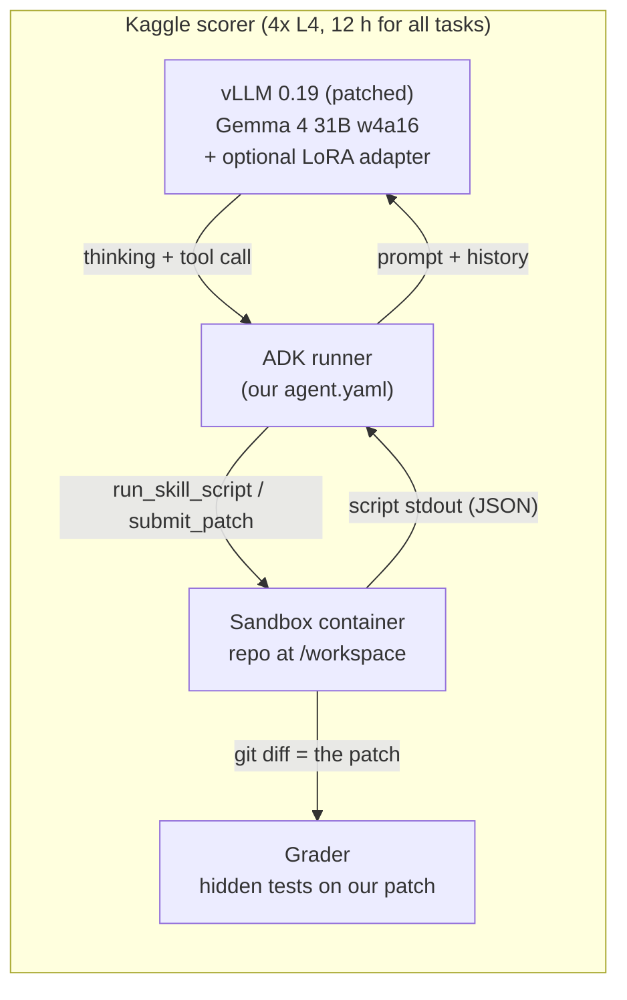
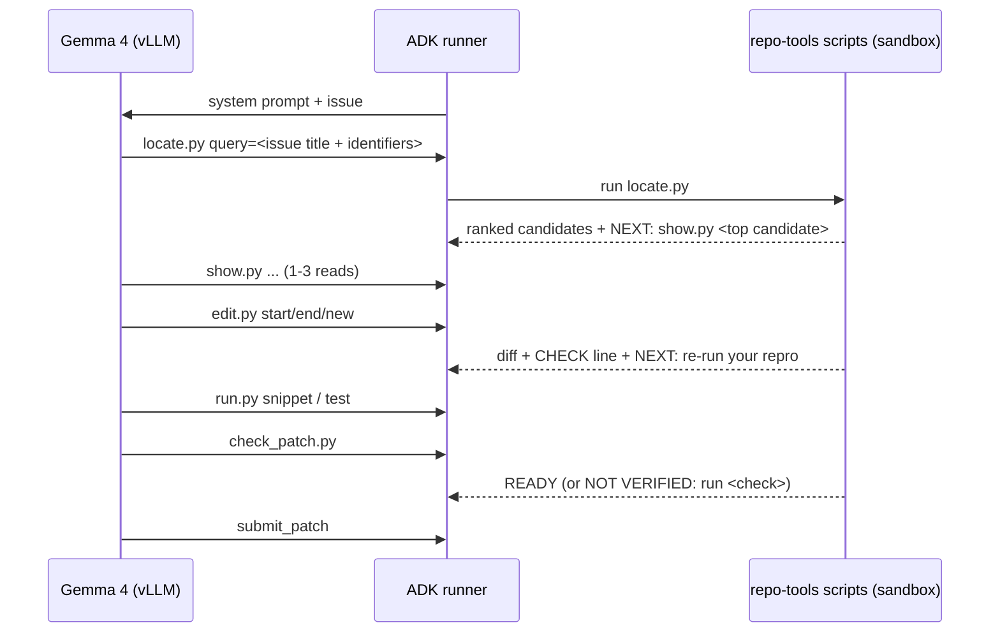
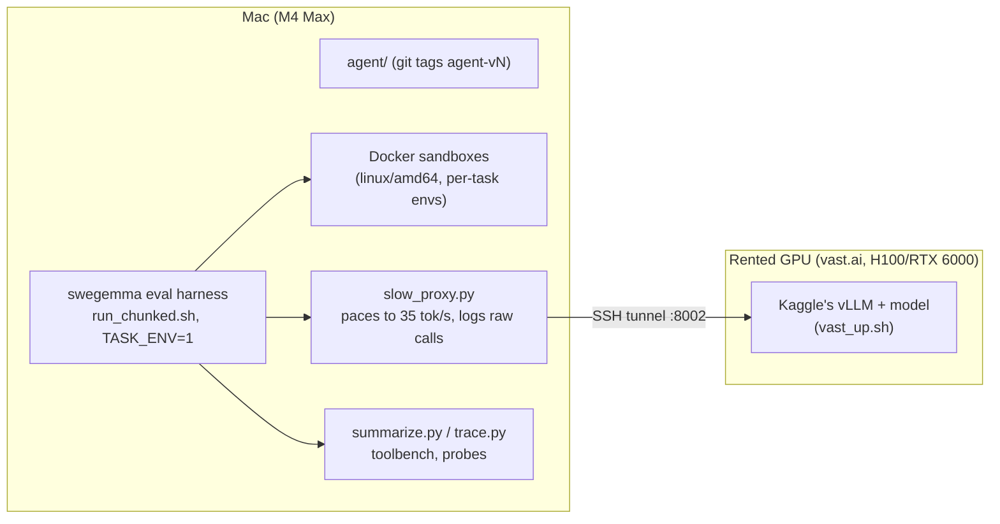

# Architecture

How our entry works, from the Kaggle scorer down to a single script call, and how we develop and test it.
For the training side (LoRA), see [lora.md](lora.md).

## 1. What Kaggle does with our submission

We submit a zip with a declarative Google ADK agent, a folder of YAML, prompts and scripts. We never submit Python
that drives the loop: Kaggle's scorer owns the loop. For each of the ~120 hidden tasks, run one after another:



- **Model:** `gemma-4-31b-it-qat-w4a16-ct`, served by vLLM with tensor parallelism over 4 L4 GPUs. At real Kaggle
  speed one stream decodes at ~33–39 tokens/s (our L4 probe, 2026-10-07).
- **Budgets:** we set them in `agent/eval_config.yaml`: 4.0 min per task, 40 tool calls, 100 turns, 180 s test
  timeout. The 12 h limit covers all tasks plus container setup. Overrunning it errors the whole submission
  (we suspect two of our submissions died that way).
- **Grading:** the scorer takes `git diff` of `/workspace` (submitted or not), applies the hidden tests in a fresh
  checkout and counts a pass only if they all pass. Score = share of tasks passed. The public leaderboard shows 58
  of the tasks, truncated to 2 decimals: 0.10 is 6 tasks and 0.17 is 10.
- **Context:** 32k tokens. ADK compacts the history at ~14k tokens (the scorer's setting) and keeps only the
  model's *visible text*, not tool results, so the agent can lose what it read.

## 2. Our agent

```
agent/
  agent.yaml           name, model, prompt, the skill, 2 tools, sampling (no sub-agents)
  prompts/system.md    ~80 lines: how to call scripts, the usual path, rules; {problem_description} at the end
  configs/sampling.yaml  temperature 0.2, max 1536 output tokens/turn, thinking on with a 256-token budget
  eval_config.yaml     the 4 budget fields the scorer reads
  skills/repo-tools/   SKILL.md + scripts/ (21 stdlib-only Python files, ~13k lines)
```

The agent is **one ADK agent with a narrow interface**: two built-in tools (`get_status`, `submit_patch`) and one
skill (`repo-tools`) whose scripts it runs with `run_skill_script`. It has no raw shell, file reader or file writer.

Why narrow? Early versions with the stock tools (`run_command`, `read_file`, `edit_file`, …) looped. For example,
with thinking off, v7 sent the same command 29 and 53 times. Edits also failed often (up to 70% "old_string not found",
because tool results arrive JSON-escaped). Scripts let us bound output, repair malformed arguments and attach guidance
to every result. Staff confirmed this is allowed: custom tools go in as "scripts in a skill" (forum thread 743573).

### The scripts

| Script | What it does |
|---|---|
| `locate.py` | Ranks the files and functions most likely to change for the issue (lexical index of the repo, identifiers from the issue). Always the first call. |
| `show.py` | Prints a function, class or line range with line numbers, plus where the names it uses are defined. |
| `search.py` | Literal or regex search with bounded output, naming the function each hit is in. |
| `edit.py` | Replaces lines by number or text by text, up to 4 hunks per call. Tolerates escaped text, infers missing end lines, refuses syntax errors and test edits, prints a diff and a CHECK line (compiles, new undefined names, module import, shadowing). |
| `create.py` | Creates a new file. |
| `run.py` | Runs a short snippet or one test file, bounded in time and output. After an edit, says whether the output changed. |
| `check_patch.py` | Reviews the working tree before submit. Since v21 it says NOT VERIFIED until a relevant check ran after the last edit. |
| `callers.py`, `outline.py`, `tests_for.py`, `history.py`, `status.py` | Extra lookups, still callable but no longer listed in the prompt (fewer choices helped). |
| `flow.py`, `kb.py`, `guards.py`, `argfix.py`, `names.py` | Helper modules, not commands: the flow engine, the code index, edit guards, argument repair. |
| `repro.py`, `reproduce_*.py` | Aliases for script names the model invents, so those calls still work. |

### The flow engine (`flow.py`)

The scorer gives the model no clock and no memory beyond its context, so every script call goes through a small
state machine. It stores state in sqlite under `<workspace>/.git/repo_tools`, inside `.git` so it never shows up in
the patch. Every result ends with a footer:

```
BUDGET: call 11 of 40 | 1m56s of 3m40s used | edit now
NEXT: edit your best candidate now: edit.py  target=fastapi/dependencies/models.py  start=105  end=118  new=<...>
NEXT: or by text: edit.py  target=...  old=<exact current lines>  new=<new lines>
```

- **NEXT lines** are the recommended next call with values filled in: read the top candidate after locate, edit
  the region just read, re-run the repro after an edit, then check_patch, then submit.
- **BUDGET** turns into "edit now" or "submit now" by time and call count. When it fires matters a lot: too early
  gives premature, wrong submits; too late gives empty patches (E064–E066).
- **Refusals** (`NOT RUN: …`): identical repeated calls, too many snippets before any edit, too many checks after
  an edit, reads when the context is nearly full. Never two refusals in a row, so the model can't get stuck.
- **MEMO** lines restate the files, lines and state after a presumed compaction, since ADK dropped the tool results.
- **Context estimate:** a fitted formula (base + characters × 0.295 + calls × 336 tokens) predicts the prompt size
  without seeing it, to time MEMOs and the "context nearly full" guard.

The design idea: the model is good at local decisions (what this code does, what to change) and bad at global ones
(when to stop reading, when to submit, remembering what it saw). The scripts carry the global part.

### One task, typically



At real speed a task takes ~20 calls and ~3 minutes on average. About a quarter hit the 4-minute limit.

## 3. How we develop and test



- **Model server:** a rented GPU runs Kaggle's own vLLM build (`scripts/vast_up.sh`); the Mac reaches it through an
  SSH tunnel. llama.cpp on the Mac (`serve_local.sh`) works for smoke tests but is too slow for real evaluations.
- **Speed emulation:** `slow_proxy.py` slows responses to Kaggle's speed (`--decode 35 --prefill 3000`).
  This matters: for a week we emulated 12 tok/s (a forum figure) and drew conclusions that turned out to be
  artefacts.
- **Kaggle-like settings:** compaction at 14,336 tokens, the scorer's chat template, the Kaggle app
  (`SWEGEMMA_KAGGLE_APP=1`) and per-task Python environments (`TASK_ENV=1`). With those, 115 of 129 training tasks
  pass with the gold patch.
- **Task lists:** `experiments/eval113.txt` (the 113 usable training tasks), smaller lists for quick checks.
- **Analysis:** `summarize.py` (pass counts, Fisher p), `trace.py` (per-call view), plus offline checks that need
  no model: toolbench (edit.py on real failed edits), locate_bench, replays of old traces through new scripts.
- **Bookkeeping:** every experiment in `experiments/LOG.md`, every GPU rental in `experiments/spend_map.tsv` →
  `SPEND.md`.

### Versions

Every agent version is a git tag (`agent-v5` … `agent-v21b`). `scripts/materialize.sh <tag> <dir>` exports one for
an A/B or a Kaggle notebook. Leaderboard history so far:

| Version | What changed | Public LB |
|---|---|---|
| v5 | coder + localizer sub-agent, stock tools | 0.05 |
| v7 | one agent + first repo-tools scripts | 0.00 |
| v14 | quote-free call notation, soft budget, richer reads | 0.10 |
| v16 | snippet discipline, multi-site edits, context guard | 0.06 |
| v18d | flow engine with compaction awareness, thinking budget 256 | 0.10 |
| v18d + rft2 LoRA, v19b | | system error (probably the 12 h limit) |
| v20b | robust edits, CHECK line, multi-edit, 4.0 min/task | pending |

## 4. Known gaps

- **Local vs leaderboard:** ~42% local at real speed vs 0.10 on the leaderboard. Other teams report the same kind
  of gap (local 0.23 → leaderboard 0.12). Part of it may be the task dates. On our training tasks, issues from 2024
  or earlier pass ~52% and 2026 issues ~32%: newer issues are harder or less familiar to the model. The hidden
  tasks may also be newer, from other repositories, or more strictly filtered.
- **Noise:** the same agent scored 8/12 and 2/12 on the same tasks on different nights. One leaderboard
  submission (58 tasks) moves by ±2–3 tasks from chance alone.
- **Fix quality:** about half of wrong patches can't be fixed from the issue text alone (the hidden tests expect a
  specific message, name or behaviour the issue doesn't state; note 16).
