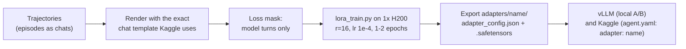

# LoRA: how it works, and how we use it

The competition allows one thing to change in the model: a **LoRA adapter** loaded on top of
`gemma-4-31b-it-qat-w4a16-ct` (staff: "only able to accept LoRA adapters", at most 3 GB). This page explains
LoRA from scratch, then our pipeline and what we learned.

## 1. The idea in one picture

A transformer is mostly big matrix multiplications. Every layer projects its input `x` with weight matrices
(`q_proj`, `k_proj`, `v_proj`, `o_proj` in attention, `gate_proj`, `up_proj`, `down_proj` in the MLP). Gemma 4 31B
has 60 such layers and ~31 billion weights in total.

Full fine-tuning would update all of them, which means 31B gradients, optimizer states and a 60+ GB checkpoint.
LoRA (Low-Rank Adaptation, Hu et al. 2021) instead **freezes** every original weight `W` and learns a small
correction:

```
y = W x + (alpha / r) * B (A x)

W : d_out x d_in   frozen (the original model)
A : r x d_in       trained   (starts random)
B : d_out x r      trained   (starts at zero, so at step 0 the model is unchanged)
r : the rank, small (we use 16; the matrices are thousands wide)
```

`B·A` is a `d_out × d_in` matrix like `W`, but it's built from two thin matrices, so it can only express
"low-rank" changes: a few directions in which the layer's behaviour shifts. That's usually enough to teach
**habits and formats** (how to call tools, when to edit, what style to answer in). It's much less effective at
teaching new knowledge.

- **Size:** for us, r=16 on 5 projections × 60 layers is 600 small tensors, ~106M trainable numbers (~0.34% of the
  model), and a 212 MB file. The starter kit's sample adapter is r=4 on q/o only (0.2 MB).
- **alpha:** a scale. `alpha / r` sets how loud the adapter is (we use alpha 32, r 16, so ×2).
- **Serving:** vLLM keeps one copy of the base model and adds `B(Ax)` at runtime for requests that name the adapter.
  The math is the same as merging `W + (alpha/r)·B·A`; the extra matmuls cost some speed (our adapter decodes at
  ~30–35 tok/s vs ~35–39 without, on Kaggle's L4s).

## 2. How training works

Training is ordinary next-token prediction, with two twists:

1. **Only the adapter learns:** gradients flow through the frozen model into `A` and `B` only.
2. **The loss counts only the tokens we want to teach.** An agent episode is a long chat: system prompt, the issue,
   then alternating model turns (thinking + tool call) and tool results. We compute the loss only on the
   model's own turns (the "labelled" tokens), never on the prompt or the tool output, which the model shouldn't
   learn to produce.



The details that cost us the most time:

- **Quantized base:** the served model is 4-bit (w4a16). We load the checkpoint, dequantize it to bf16 on exactly
  the grid vLLM serves, and train the adapter on top. The adapter therefore learns corrections for the model
  Kaggle actually runs.
- **No k/v adapters:** on Gemma 4's 10 global layers, Hugging Face computes V from `k_proj` while vLLM fuses it
  differently, so an adapter on `k_proj`/`v_proj` would behave differently at serving time. We train `q, o, gate,
  up, down` only.
- **Memory:** sequences are up to ~25k tokens. Peak memory is ~99 GB, so training runs on a rented H200 (141 GB),
  with gradient checkpointing and logits computed only where the loss is counted (the 262k vocabulary is huge).
- **Speed:** most time goes into attention. A custom "chunked" path for the 50 sliding-window layers took training
  from ~470 to ~1,000 tokens/s.
- **Chat template:** the training text must match what the model sees on Kaggle token for token, including the
  thinking format. Otherwise the adapter learns a format it never sees in use.

## 3. Where training data comes from

This is the real problem. LoRA itself is mechanical. What it learns depends entirely on the trajectories you feed it.

| Name | Data | Idea |
|---|---|---|
| **rft1** | 46 of our agent's own **passing** episodes (137k labelled tokens) | Rejection-sampling fine-tuning (RFT): run the agent, keep what worked, train on it. "Do more of what you already do when you succeed." |
| **rft2** | 65 passing episodes + 103 "format repair" rows (malformed calls rewritten correctly) | Same, plus fixing tool-call shapes Kaggle's parser rejects. |
| **rft3** | 1,199 sequences / 10.2M tokens: **oracle** trajectories built from SWE-bench training tasks (scripted runs that know the gold patch and take the ideal path), relabelled states, and the model's own thinking sampled to justify each step | Imitation of an expert. Teaches the ideal path, including on tasks the agent never solved. |

## 4. What happened

| Adapter | Training cost | Result |
|---|---|---|
| rft1 | ~1 h H200, ~$6 | Local 17 vs 16/36 (no measurable gain). Fewer never-edit runs (6 → 2), tasks 13% faster. |
| rft2 | 2.1 h H200, ~$12 | Held-out 8 vs 5/37 (not significant). Malformed calls 6.7% → 1.9%. Submitted with v18d, ended in a Kaggle system error (probably the 12 h limit, not the LoRA: LoRA serving works on Kaggle's L4s, checked in our L4 probe). |
| rft3 | 2.9 h H200 + bench, ~$16 | Did what it was trained for: on states where the right code is on screen, it edits 49% of the time vs 11% for the base model. But in real runs it **thrashed**: edits earlier, fails more edits, times out more. Held-out 14 vs 16/37. Shelved. |

**Lessons so far:**

1. **LoRA teaches behaviour, not insight.** rft2 fixed formats; rft3 made the model edit sooner. Neither made its
   fixes more correct, and correctness is now our bottleneck (about half of wrong patches can't be fixed from
   the issue text alone).
2. **Off-policy imitation is risky.** rft3 learned from oracle runs that never make mistakes, so it never saw how
   to recover from one. Its edit turns were also trained mostly without thinking. The model learned to edit
   quickly, but without the reasoning that makes an edit right. Training on the model's own trajectories
   (on-policy, like rft1/2) avoids this but gives little data.
3. **Measure before believing.** Every adapter looked good on its training metric (loss halves) and on narrow
   probes. Only full real-speed A/Bs showed the effect on passes, and those are noisy (±3 tasks on 37).

## 5. What would likely work better

These are the standard next steps in the literature (SWE-Gym, SWE-smith, the Nemotron and Qwen coder
reports):

- **On-policy RFT at scale:** run the current agent many times on hundreds or thousands of tasks with
  environments, keep the passing runs, and train on those. That's rft1 with ~20× more data. The cost is mostly
  generation (GPU hours) and task environments (Docker images).
- **Train the verification habit:** episodes where the model edits, runs a check, sees a failure and fixes it.
  Rejection sampling selects for these naturally if the harness runs checks (v21 does).
- **RL (e.g. GRPO with the test result as reward):** the strongest results in the literature, but expensive for
  a 31B model; probably beyond our budget.

## 6. How to run it (reference)

```bash
# build training rows (example: rft3 pipeline)
python3 scripts/rft3_build.py ...            # -> data/rft3/train_tokens.jsonl (rendered + loss masks)
# train on a rented H200 (scripts/lora_train_h200.sh wraps setup + this)
python3 scripts/lora_train.py --model /models/gemma-4-31b-it-qat-w4a16-ct --data data/rft3/train_tokens.jsonl \
    --out /root/lora_out --name rft3 --attn-sliding chunked --lora-bf16
python3 scripts/lora_train.py --tiny --data ... --out /tmp/lora_tiny   # CPU self-test, every code path
# serve for an A/B: several adapters on one vLLM server
LORA="rft2=results/lora/rft2/adapters/rft2,rft3=results/lora/rft3/adapters/rft3" scripts/vast_up.sh <offer>
```

On Kaggle, the adapter folder goes into the submission zip and `agent.yaml` names it (`adapter: <name>`).
