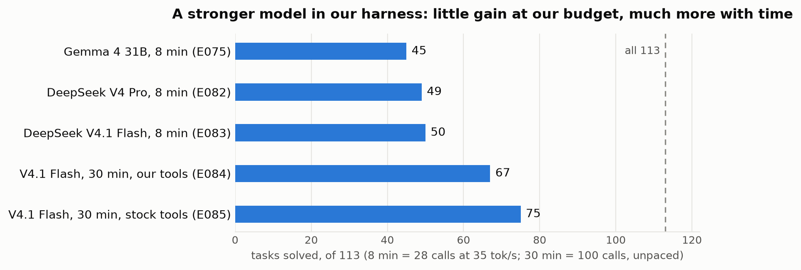
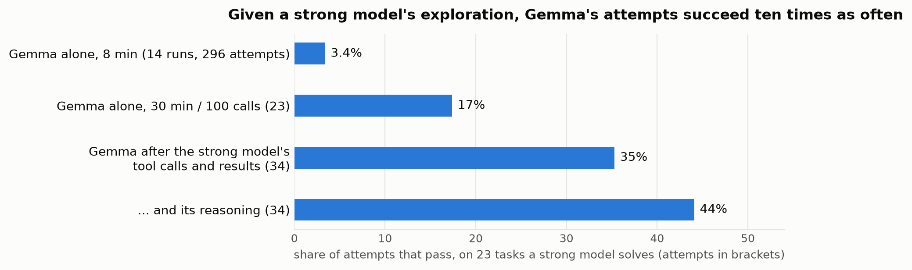

# Moving Failures Around

**A small coding agent acts on information it is shown, not on instructions to find it**

*Draft 6, 2026-11-05. Numbers from experiments/LOG.md (experiment ids in brackets) and results/_analysis scripts;
every number was re-counted from the raw results. References were opened and checked (research/notes/1-3, 19,
20-parts/W1-W2, 23).*

## Abstract

Can a 31B open model, quantized to 4 bits and decoding about 35 tokens per second, fix real GitHub issues within
minutes? For the Gemma 4 Developer Agent competition we built an agent with a narrow scripted interface, a
deterministic "flow engine" that steers every call, and LoRA adapters, and ran about 2,800 real-speed episodes
(about 6,000 in all) to ask what moves its solve rate.

1. Changing when the harness pushes the model to edit, adding a review, or giving it more time moved up to 14 of 113
   tasks between "wrong patch" and "no patch"; solves stayed within ±1. Adapters trained on scripted or strong-model
   trajectories copied the behaviour (edit early, explore long) but not what made it work.
2. A much stronger model driving the same agent shows where the limit is: at our budget it gains 4–5 tasks, but with
   30 minutes and 100 calls it solves 67 of 113 with our tools and 75 with stock tools. The budget binds.
3. On 23 tasks the strong model solves and Gemma rarely does (3.4% of Gemma's real-budget attempts), Gemma's attempts
   succeed 17% of the time with 30 minutes, 35% when it continues from the strong model's tool calls and their
   results, and 44% with its reasoning too. Much of what Gemma lacks is information from experiments.
4. Gemma uses information the harness hands it but rarely acts on instructions to gather it: it follows read
   suggestions 70% of the time and edit suggestions 0–9%; a ready-made experiment tool was used in 2 of 46 attempts;
   the right tests, shown without being asked for, did not change outcomes.

We also report three evaluation pitfalls, one of which reversed our diagnosis, a replay method that isolates
information from capability, and a reading of the public leaderboard as best-of-n selection.

## 1. Introduction

Coding agents built on frontier API models fix a large share of SWE-bench issues. The competition asks whether a model
that fits on modest hardware can do this offline: Gemma 4 31B (w4a16) served by vLLM on 4× L4 GPUs, with about 120
hidden tasks from private repositories run one after another within 12 hours.

In this regime the time budget shapes every design choice, and local evaluation is noisy: the same agent scored 46/113
twice with 6 tasks flipping each way. We report what a learning-first team found after over 30 agent versions, 4 trained LoRA
adapters and about $215 of rented compute and API calls, every experiment logged with its cost.

Contributions:
- an evaluation protocol that reproduces the scorer's conditions and reports outcomes as failure modes (§4);
- evidence from timing, review, time, fine-tuning and test-delivery interventions that the solve count is conserved
  while failures move between categories (F1, F2, F5);
- a decomposition of the gap with a strong model in the same harness and a *handoff* replay that gives the small model
  a strong model's exploration, with and without its reasoning (F3, F4);
- an account of what limits the rest, a transfer test on 99 unseen repositories, and a best-of-n reading of the
  leaderboard (F6).

## 2. Setting

- **Model and serving:** Gemma 4 31B-it, QAT w4a16, vLLM with tensor parallelism over 4× L4: 33–39 tok/s decode.
- **Agent:** a declarative Google ADK agent (YAML, prompts, tools, optional LoRA); Python runs only in the sandbox.
- **Context:** 32,768 tokens; at 14,336 tokens ADK replaces all but the last 5 events with a model-written summary of
  their text (tool calls and results are dropped).
- **Budget per task (ours):** 8 minutes, 28 tool calls, a 240 s command timeout, a 4,096-token thinking budget.
- **Scoring:** a task passes if all its hidden tests pass on the final working tree; the public leaderboard shows 58.
- **Local data:** the competition's 129 tasks (fastapi, rich, requests, httpx); with per-task environments 115 pass
  with the gold patch, and we use 113 (eval113).

## 3. System

**Narrow interface.** With the stock file tools, up to 70% of an early version's edits failed because tool results
reach the model JSON-escaped (with thinking off, another repeated one command up to 53 times). One skill of stdlib scripts
replaced them: `locate.py` (BM25-style ranking of files and functions), `show.py` (a function plus where its names are
defined), `search.py`, `edit.py` (line-range edits with a syntax and import check), `run.py` (a bounded snippet or
test) and `check_patch.py`. They share two SQLite stores: a code index (symbols, references, imports, which tests
exercise what, co-change from git history, full-text search) and a task memory (calls, reads, candidates, edits,
checks) that drives a footer under every result: the next call with its arguments filled in, a budget line, refusals
of repeats, and a `MEMO:` line that restates the task after compaction.

## 4. Evaluation method

**Faithful conditions.** A pacing proxy slows a rented GPU's vLLM (the scorer's build) to 35 tok/s decode and the
measured 1,400 tok/s uncached prefill, charging only the prompt tokens the server reports as uncached. Runs use the
scorer's template, compaction and harness version, each arm's budgets, and per-task Python environments (52 of 129
gold patches pass in the shared stock environment, 115 with per-task ones). The same proxy fronts hosted models
(§F3).

**Outcomes and noise.** Each run ends as pass, wrong patch or empty patch. Arms are compared on the same tasks with a
sign test on the tasks only one arm solves. Identical leaderboard submissions scored 0.12–0.20 (7–12 of 58).

**Replay and handoff.** A replay server answers the harness with a recorded run's model responses, so the real harness
repeats its tool calls in real sandboxes with no GPU. In handoff mode it replays a strong model's responses up to its
first edit and then forwards every request to Gemma: Gemma continues with the strong model's exploration in its context
and writes the fix itself. Optionally the replayed responses are stripped of reasoning and text, leaving only the tool
calls and their results.

**Three pitfalls.** (a) A community estimate put Kaggle's speed at 12 tok/s; at that pace our agents solved 25/113 with
~60% empty patches, and "never edits" looked like the main failure, which motivated an adapter trained to edit
earlier (F2). At the measured 35 tok/s the same agents solved ~42%, empty patches fell to 17–29%, and the failure that
remained was fix quality. (b) We
inferred that the chat template defeats vLLM's prefix cache; server counters showed 90% of prompt tokens cached.
(c) One pair of runs spent ~130 s per task in our scripts against ~13–25 s normally, on a loaded host; the replay
server reproduced identical patches and outcomes on 7 tasks at normal speed. We now gate every run on per-call tool time.

## 5. Findings

### F1. Harness changes conserve failures

| Change (budget) | Runs | Pass | Wrong | Empty |
|---|---|---|---|---|
| time-only budget + verify gate (4 min) | E064 → E065 | 43 → 43 | 55 → 41 | 15 → 29 |
| early "edit now" trigger | E065 → E066 | 43 → 42 | 41 → 50 | 29 → 21 |
| grounded review + read a test first (8 min) | E069/E070 → E073 | 46 → 47 | 52 → 42 | 15 → 24 |
| ~2 more minutes of model time (unseen repos) | E076 → E081 | 34 → 34 | 44 → 49 | 21 → 16 |
| *stock-tools agent, 38 tasks:* rules for reliable edits | E106 → E107 | 13 → 12 | 15 → 20 | 10 → 6 |
| two sub-agents that search in parallel first | E110 → E111 | 15 → 13 | 19 → 7 | 4 → 18 |

Interventions on *when* to act shift tasks between "no patch" and "wrong patch", which score the same. The tasks that
move are those the model cannot fix correctly either way. The pattern held when we moved to the public stock-tools
agent (last rows): scouts that hand the solver locations and code cost it budget; with a time-only budget they tied
(9 vs 8 of 23 tasks) and took 10% longer per task [E112/E113].

### F2. Fine-tuning copies the behaviour, not what made it work

LoRA adapters do apply on the scorer's stack: in a free Kaggle notebook with the competition's wheels and server
class, a zero adapter left 5 greedy replies unchanged, a mild one and our trained adapter changed 3, and a loud one
produced garbage. A LoRA on 1,199 sequences of scripted oracle trajectories and relabelled states raised
P(edit | gold code visible) from 0.11 to 0.49, but in real runs it solved 14 vs 16 with twice as many failed edits
[E062/E063]. An adapter trained on the agent's own passing runs (rft2) fixed call format (malformed calls 6.7% → 1.9%)
and left the leaderboard score unchanged. The mirror image came from 41 successful DeepSeek trajectories (§F3), with
its reasoning as Gemma's thinking and turns that recall the upstream fix masked (ds1). On the 24 unseen tasks both runs
reached before the server serving the adapter hung, it edited in 7 runs (without the adapter 23), ran 32.7 shell
commands per run against 9.0, and solved 2 against 6 [E095/E096]. One
adapter learned to edit early, the other to explore long; neither learned the judgement or the speed behind them.

### F3. A strong model in the same harness: the budget binds, the tasks do not cap

DeepSeek V4 Pro (MIT weights; its model card reports 80.6% on SWE-bench Verified in maximum-effort mode) and its
smaller sibling V4.1 Flash
drove the agent through the pacing proxy [E082–E085] (Figure 1):

| Model, tools, budget | Pass | Wrong | Empty | Timeouts |
|---|---|---|---|---|
| Gemma 4 31B, ours, 8 min at 35 tok/s (E075) | 45 | 50 | 18 | 12 |
| V4 Pro, ours, same (E082) | 49 | 31 | 33 | 27 |
| V4.1 Flash, ours, same (E083) | 50 | 14 | 49 | 58 |
| V4.1 Flash, ours, 30 min / 100 calls, unpaced (E084) | 67 | 44 | 2 | 0 |
| V4.1 Flash, stock tools, 30 min / 100 calls (E085) | 75 | 37 | 1 | 0 |

- At our budget the strong models gain 4–5 tasks (Pro vs Gemma 10:6, p = 0.45) while timing out more: a stronger model,
  too, moves failures from wrong to empty.
- The budget binds: Flash solves 50 → 67 with room (2 vs 19 discordant, p < 0.001), and 75 with stock tools. Our
  scripts guard Gemma against its own failure modes (v22 46 vs 40 for a public stock-tools agent, 12:6, p = 0.24; tied
  34:34 on unseen repositories) but do not help a strong model search (75 vs 67, p = 0.06).
- 23 tasks are solved by some DeepSeek run and by none of four Gemma runs (E069, E070, E073, E075).

### F4. Handoff: what Gemma lacks is information

On those 23 tasks [E088–E092] (Figure 2):

| What Gemma has | Attempts | Solved | Tasks solved |
|---|---|---|---|
| its own exploration, 8 min (all 14 real-budget runs) | 296 | 3.4% | 10 solves in 14 runs |
| its own exploration, 30 min / 100 calls (E092) | 23 | 17% | 4 |
| the strong model's tool calls and results, then its own fix (E090/E091) | 34 | 35% | 8 |
| the same plus the strong model's reasoning (E088/E089) | 34 | 44% | 10 |

Given a strong model's exploration without any of its analysis, Gemma's attempts on these tasks succeed ten times as
often. The exploration rarely read files Gemma had not also read: before its first edit the strong model ran 4.4
experiments per attempt against Gemma's 1.7, designed to expose the failure (one compared a reference implementation
over generated inputs and printed every mismatch; Gemma tried one example), and sometimes read history or tests. It
took a median of 23–34 calls before the first edit; Gemma's whole budget is 28. Even with that exploration, 15 of the
23 tasks stay unsolved: information is the larger, not the only, gap.

### F5. Shown, not told

Gemma acts on what the harness puts in front of it, not on instructions to act:
- **Advice:** in 113 traces the next call followed "read the top candidate" 70% of the time and the footers pushing an
  edit 0–9% (most 4–9%). A co-change hint named a missed file in 5 of 6 runs; the model edited it once [E078/E079].
- **Delivered tests:** v27 prints the repository's own tests of the code being read, at no call cost; it showed a file
  the hidden tests modify in 64% of findable tasks, yet scored 46 vs 45 and 35 vs 34, and the same on the tasks
  where the shown file was right (23 vs 23, 24 vs 22) [E086/E087].
- **Experiments:** a probe that runs one call over many edge-case inputs and prints the mismatches, suggested with the
  import and the call filled in, was used in 0 of 10 tasks where it appeared when it required the model to state the
  expected behaviour (1/23 solved) [E093]. A version that needs nothing written, for one-argument functions, was
  offered in 2 tasks; the probe was run in 2 tasks, once with inputs the tool misread, and 1/23 solved [E094].

The harness can deliver facts; the experiments that produce the decisive facts need a judgement Gemma does not make.

### F6. What limits the rest, and transfer

- **Unstated requirements:** of 134 wrong patches, each read and classified with model assistance, 49% miss a name,
  message or behaviour the hidden
  tests expect but the issue does not state; wrong logic 19%, wrong location 14%, incomplete 11%, tooling 1.5%.
- **Fix size and recency:** on unseen tasks no gold patch longer than 80 lines was solved in any run (0/9; ≤ 10 lines
  19/38 in E081); over 1,440 real-speed attempts on eval113, tasks from 2024 or earlier passed 47% [41–52] against 32%
  [28–36] for 2026, also within rich (45% vs 24%) and fastapi (2025 H2 41% vs 2026 26%).
- **Transfer:** on unseen100, 99 tasks from 99 repositories we never tuned on, created after the model's cutoff, v24
  solved 34/99 in two runs (45/113 locally) and a public stock-tools agent tied (34, discordant 9:9).
- **Leaderboard:** four submissions of our agent and a stock-tools variant of that public agent (v30) solved 7–8 of
  the 58 public tasks (0.12–0.13); our variant with a quarter of the thinking budget and 36 calls 0.15, and the public
  agent unchanged 0.18 [TODO v40], all within the 0.12–0.20 of identical submissions. Across 2,997 teams the best score rises with the number
  of submissions: a median of 0.08 for the 639 teams with one, 0.13 with 4–6, 0.15 with 7–10 and 0.17 with 11–20; the
  teams at 0.22–0.24 have a median of 9–11. For an agent with a true rate of 0.13, the best of 8 submissions averages
  11.3 tasks (about 0.19) and reaches 14 (0.24) one time in ten. The public top is consistent with selection over
  agents like ours, not evidence of a better one; the private leaderboard scores two chosen submissions on other
  tasks.

## 6. Related work

- **Benchmarks:** SWE-bench (Jimenez et al., ICLR 2024, arXiv 2310.06770), SWE-bench Verified and SWE-Bench Pro (a 3×
  drop when interface specifications are withheld, consistent with our unstated-requirement share).
- **Agent scaffolds:** SWE-agent's agent-computer interfaces (Yang et al., NeurIPS 2024, arXiv 2405.15793); OpenHands'
  final review and SpecRover's grounded reviewer; Agentless and Co-PatcheR rely on sampling budgets we do not have.
- **Training:** SWE-Gym (arXiv 2412.21139; self-improvement 19.0 → 19.7 at 32B), SWE-smith and Step Rejection
  Fine-Tuning (teacher trajectories), DeepSWE (RL). Our handoff isolates the teacher's information from its reasoning.
- **Self-critique:** Huang et al. (ICLR 2024): unguided self-correction is unreliable.
- **Harness design:** Barbaste et al. (arXiv 2609.00006) document behavioural policy moving from prompts into tools.

## 7. Limitations and conclusion

- **Limitations:** one agent model; four public repositories for tuning, 99 others for transfer; 23 tasks in the
  handoff study, selected because Gemma failed them in four runs (its rate over all 14 runs, 3.4%, is the baseline),
  with one or two attempts per task and condition; the strong-model runs used a harness tuned on Gemma; the ds1
  comparison was cut to 24 tasks by a server hang; 58 leaderboard tasks.
- **Guidance for budgeted local agents:** pace evaluations at the measured speed and gate runs on tool time; report
  failure modes; expect timing, review and imitation changes to move failures rather than remove them; before building
  a tool, check whether the model will act on it without being told; measure a strong model in your own harness.
- **Conclusion:** within one 8-minute attempt, a small model's main limit here is not writing fixes but finding the
  facts that make a fix right, and it seldom seeks them when told to. Delivering static facts (the right tests) did
  not help; what helped was the outcome of experiments designed to expose the failure. Raising the ceiling needs those
  outcomes produced without the model's judgement, or more attempts with selection. On the leaderboard our agent and
  the stock-tools variant both solve 7–8 of 58; the public top is what selection over many submissions predicts.
- **Release:** the agent, evaluation tools (pacing proxy, per-task environments, replay and handoff server), the
  unseen100 task list and builder, and per-task outcome tables, without competition data.

*Word count target: ≤ 3,000.*
